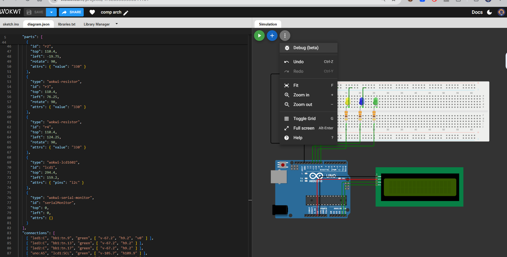
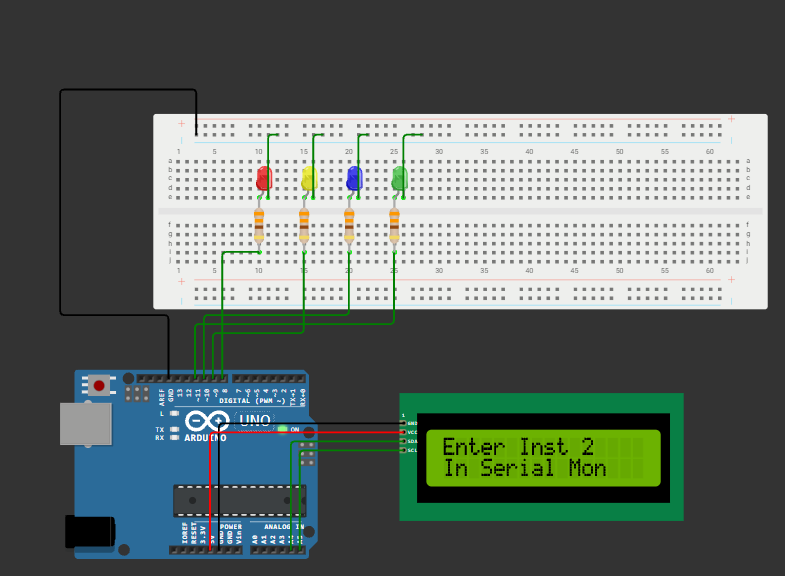
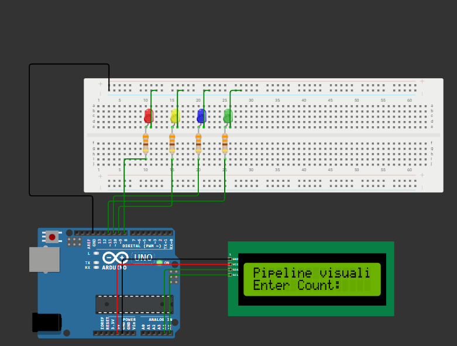
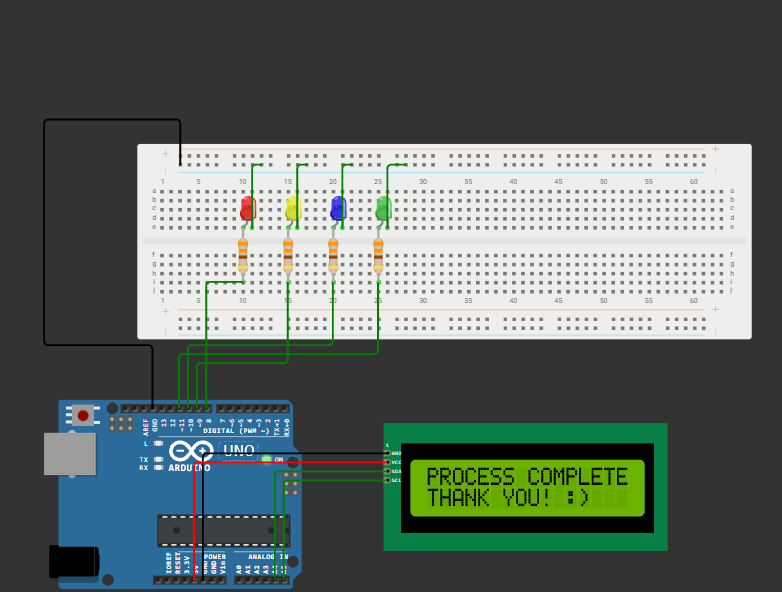

# Pipeline Visualizer with Automatic Data Hazard Detection and Resolution

A simulator that shows how instructions move through a CPU pipeline stage by stage, and automatically detects and resolves data hazards.

## What It Does

- Simulates a 5-stage CPU pipeline (IF, ID, EX, MEM, WB).
- Automatically detects data hazards such as **RAW (Read After Write)**.
- Resolves hazards using **forwarding** and/or **stalling** (pipeline bubbles).
- Displays a cycle-by-cycle pipeline diagram showing where each instruction is at every clock cycle.

## Circuit Diagram



## Technologies Used

- Language: C++
- Tools: [your compiler or IDE, e.g. Code::Blocks / VS Code / Dev-C++]

## Project Structure

```
Pipeline-Visualizer/
├── SRC.CPP        Source code
├── CIRC.PNG       Circuit diagram
├── OP1.PNG        Output screenshot 1
├── OP2.PNG        Output screenshot 2
├── OP3.PNG        Output screenshot 3
├── Project_Report.pdf
└── README.md
```

## How to Run

1. Download or clone this repository.
2. Open a terminal in the project folder.
3. Compile the program:
   ```
   g++ SRC.CPP -o pipeline
   ```
4. Run it:
   ```
   ./pipeline
   ```
   (On Windows, use `pipeline.exe`.)

## Sample Input

```
ADD R1, R2, R3
SUB R4, R1, R5
AND R6, R1, R7
```

## Sample Output







The second instruction depends on R1 from the first, so a RAW hazard is detected and resolved using forwarding or a stall.

## Report

The full project report is available here: [Project Report](Project_Report.pdf)

## Author

- **Name:** T Padma Loshini
- **Reg. No:** 1250110121195
- **Class:** II-B.Tech CSE, "B" Section
